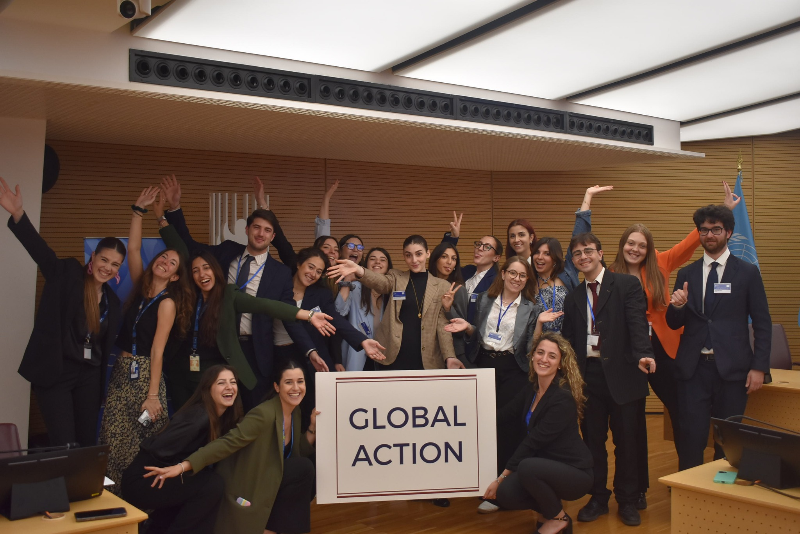
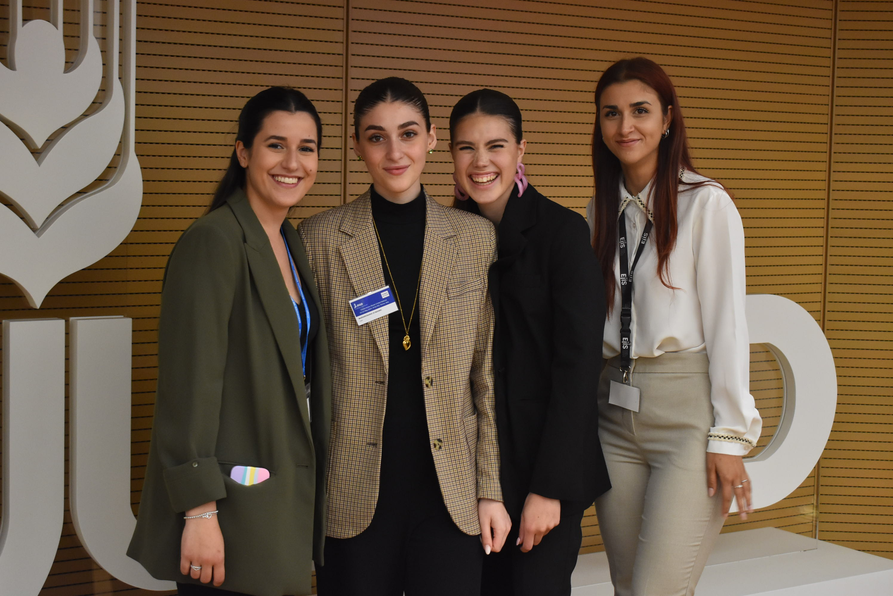
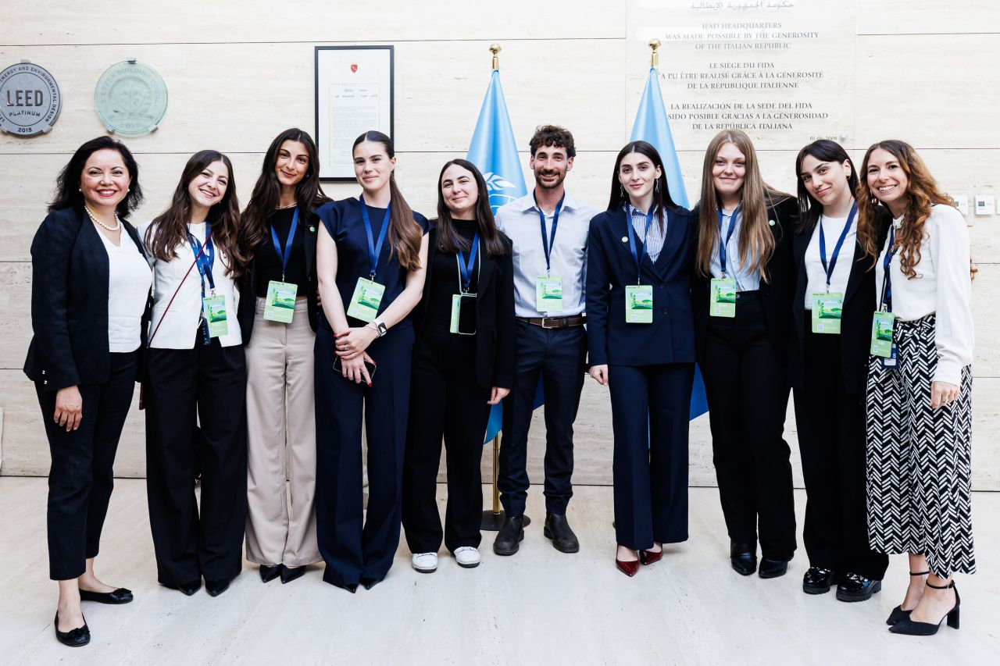
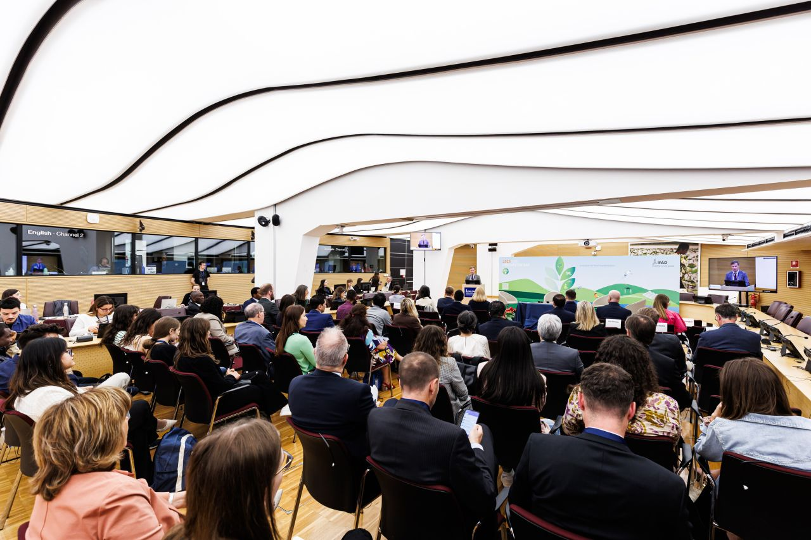
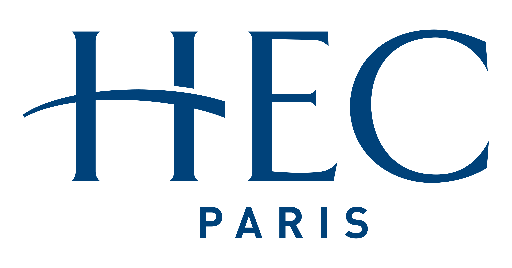

:::::::::::: columns
::: {.column width="55%"}
**My Video CV:**

<!-- Begin YouTube embed code -->

<iframe width="400" height="200" src="https://www.youtube.com/embed/3tpwWfNyDlo" title="Video Resume" frameborder="3" allow="accelerometer; clipboard-write; encrypted-media; gyroscope; picture-in-picture" allowfullscreen>

</iframe>

<!-- End YouTube embed code -->
:::

::: {.column width="10%"}
:::

::: {.column width="25%"}
**Want to Read?**

[Download My CV](docs/mariarosaria.dibagno-cv%20copy.pdf){.button download="CVResume.pdf"}
:::

::::

# Experiences
## [Global Action](https://diplomacyeducation.org)
### **Team Coordinator** *(oct.2024-oct.2025)*
At Global Action, I coordinated six interns working on the Diplomacy Education project, assigning tasks and supporting the organisation of activities for Italian high-school students. Each participating class was paired with an embassy, giving students the opportunity to learn about diplomacy through direct contact with embassy staff.

I acted as a link between the schools and their partner embassies, helping coordinate communication and activities throughout the programme. I worked with several embassies in Italy, including those of Germany, Belgium, Argentina, Indonesia and Saudi Arabia, alongside the interns supporting the participating classes.

The project formed part of the students’ alternanza scuola-lavoro programme. Through activities with their partner embassy, students explored diplomatic work and prepared to participate in a Model United Nations simulation, where they could put their learning into practice through debate and negotiation.  

{width="320" height="auto"}

### **Event Manager** *(oct.2024-oct.2025)* 

At Global Action, I helped launch **Global Action Insight**, a seminar series at UNINT in Rome that introduced high school students to diplomacy and global issues. I helped develop the themes, coordinate speakers, and present and moderate sessions.

- **Women Empowerment and Leadership in the International Context (29 January 2025)**:I co-presented the inaugural seminar, introducing speakers from diplomacy, human rights, and international organisations. The discussion explored women’s leadership and encouraged students to see how they could contribute to their communities.  
{width="320" height="auto"}

- **Climate Change (21 February 2025)**:  organised and moderated a seminar that gave students a space to discuss climate change as a global challenge and consider the role of international cooperation.  
{width="320" height="auto"}

### **Bureau Intern** *(oct.2023-oct.2024)*
As a Junior Team Intern, I supported the Diplomacy Education project by working with embassies in Italy and connecting them with Italian high schools. The project introduced students to diplomacy through accessible, high quality educational experiences.    
 

::: columns

::: {.column width="47%"}
**Key Responsibilities**

-   **Event Coordination**   

-   **Communication and Collaboration**  

-   **Database Management**   

-   **Document Preparation**  
:::

::: {.column width="5%"}
:::

::: {.column width="47%"}
**Achievements**

-   **Leadership and Initiative**  

-   **Enhanced Organizational Efficiency**  

-   **Cross-Cultural Communication**  

-   **Administrative Capabilities** 
:::

::::::

 
**GAMUN -Global Action Model United Nations**

**My Role at GAMUN 2024 (20-23 May 2024)**   In May 2024, I was part of the management team for the seventh edition of the Global Action Model United Nations (GAMUN), hosted at the [International Fund for Agricultural Development](https://www.ifad.org/en/) in Rome. This event is a flagship project of Global Action Italy’s Diplomacy Education, dedicated to promoting **accessible, high-quality education on a global scale**.

I helped plan the conference and coordinate its logistics. I also chaired the World Food Programme (WFP) committee, guiding delegates through debates on “Building Resilience: Food Assistance for Disaster-Prone Communities” and “Urban Food Insecurity: Strategies for Ensuring Access in Cities.” These roles brought together my experience in event organisation and my interest in international cooperation and global food security.

:::::: columns

::: columns

::: {.column width="45%"}
{width="320" height="auto"}

:::

::: {.column width="10%"}
:::

::: {.column width="45%"}
{width="320" height="auto"}
:::

:::::: 

:::

## [IFAD](https://www.ifad.org/en/) 

### **Event Consultant**
- **IFAD (March–May 2025)**: Supported IFAD’s Innovation Day as part of the event team, assisting with on-site logistics and helping the programme run smoothly for participants

:::::: columns

::: columns

::: {.column width="45%"}
{width="300" height="auto"}
:::

::: {.column width="10%"}
:::

::: {.column width="45%"}
{width="300" height="auto"}
:::

:::::: 

:::

- **GAMUN 2024 (April–June 2024)**: Helped plan and organise Global Action Model United Nations (GAMUN) 2024 as part of the management team, then chaired the World Food Programme committee and guided delegates’ discussions on food security.

# Certificates

:::::: columns
::: {.column width="60%"}
{width="150" height="auto" style="text-align: center"}  

-   **Fashion&Sustainability Management**  *European Institute for Innovation and Sustainability* 

[Certificate](images/1737990851491.jpeg)

{width="100" height="auto" style="text-align: center"}

-   **Luxury Management**  *Hec Paris* 

In the summer of 2024, I attended the **HEC Paris Luxury Management Programme.** This experience at one of Europe’s top business schools allowed me to dive deep into the world of luxury, exploring the intricacies of **brand identity**, **retail strategies**, and the **emotional value** behind luxury brands.  I concluded my course with an A grade: [Access Transcript](docs/Mariarosaria_DI_BAGNO_SUMMER_2024_ copy.pdf) 

This is my certificate of attendance: [Certificate](docs/Mariarosaria_DI_BAGNO_SUMMER_2024_Summer_School_Certificate.pdf)

{width="120" height="auto" style="text-align: center"}

-   **Fashion and Luxury Management**   *Bocconi University*: [certificate](images/CERTIFICATE_LANDING_PAGE~UNPKY3DH64LW.jpeg) 
:::

::: {.column width="10%"}
:::

::::::::::::

